# 💳 Awesome Online Payment Pages & Checkout 🚀

  
  
  
  
  
  
  

  <strong>A curated directory of top Online Payment Page &amp; Checkout platforms — spanning hosted SaaS checkout sessions, embedded payment widgets, branded payment links, and open-source payment orchestration engines.</strong>

  🌟 <em>Star this repo if you find it helpful!</em> 🌟

---

Discover the best hosted payment pages, embedded checkout widgets, payment links, and open-source payment orchestration platforms. Whether you need standard card processing via Stripe or PayPal, custom-branded enterprise checkout via Adyen, or fully self-hosted, commission-free checkout alternatives like Hyperswitch and BTCPay Server, this guide covers architecture, pricing, limits, and developer tooling.

---

## 📋 Table of Contents

- [📈 Sector Overview & Market Dynamics](#-sector-overview--market-dynamics)
- [🟦 SaaS / Hosted Platforms](#-saas--hosted-platforms)
- [🟩 Open-Source Software](#-open-source-software)
- [🔍 Feature Comparison Matrix](#-feature-comparison-matrix)
- [💡 Key Evaluation Criteria](#-key-evaluation-criteria)
- [💖 Support & Sponsorship](#-support--sponsorship)
- [🤝 Contributing](#-contributing)
- [📈 Star History](#-star-history)
- [📄 License](#-license)

---

## 📈 Sector Overview & Market Dynamics

The global payment gateway and online checkout software market was valued at **$26.7B – $34.2B in 2024** and is projected to expand to **$56.9B – $146.2B by 2030** at a compound annual growth rate (CAGR) of **11% to 22.8%**, fueled by mobile commerce, recurring digital subscriptions, and alternative payment method (APM) adoption. 

The industry exhibits a **bifurcated, moderately concentrated** structure: core underlying card acquisition and global processing volume are dominated by an oligopoly of mega-scale incumbents (Stripe, PayPal, Adyen, and Block/Square processing trillions collectively), while the front-end checkout software layer, regional payment orchestration, and self-hosted developer tools remain **highly fragmented** due to localized rails (e.g., Pix, UPI, iDEAL), compliance mandates, and developer demand for zero-take-rate infrastructure.

---

## 🟦 SaaS / Hosted Platforms

Commercial, cloud-hosted Online Payment Page and Checkout platforms. These providers manage PCI DSS Level 1 compliance, tokenization, 3D Secure authentication, fraud prevention, and global acquiring rails.

The table below is sorted in descending order by company scale (market capitalization or latest enterprise valuation):

| 🏢 Platform | 📊 Company Scale (Valuation / Revenue) | 🏷️ Pricing (Starting Tier) | 🎁 Free Tier Limit / Trial | ⚡ Hosted Checkout Features | 🎯 Best For |
|:---|:---|:---|:---|:---|:---|
| **[Stripe Checkout](https://stripe.com/payments/checkout)** | **$159B Valuation** (~$6.8B ARR) | **2.9% + $0.30** per transaction (domestic cards); +1.5% international | **$0/month, Pay-as-you-go** (No transaction allowance; $0 platform fee, pay strictly per successful transaction with no monthly minimums) | Pre-built responsive payment page, 100+ payment methods, Apple/Google Pay, dynamic address collection, 1-click Link checkout | Fast-growing SaaS, global e-commerce, and subscription businesses |
| **[PayPal Commerce Platform](https://www.paypal.com/business)** | **~$52B Market Cap** (~$33.2B Revenue) | **3.49% + $0.49** per PayPal/Venmo checkout transaction (2.89% + $0.29 for standard cards) | **$0/month, Pay-as-you-go** (No free volume included; $0 monthly account maintenance fee, pay only per transaction) | Hosted checkout buttons, Venmo integration, Pay Later (BNPL), vaulting, seller protection | Consumer-facing storefronts leveraging PayPal brand trust & 400M+ active wallets |
| **[Square Online Checkout](https://squareup.com/us/en/payments/checkout)** | **~$45B Market Cap** (~$24.2B Revenue) | **3.3% + $0.30** per transaction on Free plan (2.9% + $0.30 on Plus plan at $49/mo) | **$0/month Free Plan** (Unlimited transactions with zero monthly software fees; pay standard transaction rates only, or 30-day free trial on Plus tier) | Payment links, QR code checkout, buy buttons, SMS/email payment requests, inventory sync | Omnichannel retailers, pop-ups, restaurants, and SMB service providers |
| **[Adyen](https://www.adyen.com)** | **~$32B Market Cap** (~€2.36B Net Revenue) | **Interchange++ + 0.60% + $0.11** per transaction | **$0/month base software fee** (No free volume tier; requires an enterprise merchant contract with dynamic monthly minimum processing fees) | Single-platform global acquiring, drop-in checkout UI, native multi-currency payouts, risk engine | Enterprise retailers and multinational platforms needing unified commerce |
| **[Braintree](https://www.braintreepayments.com)** | **Subsidiary of PayPal** (Part of PayPal's $52B business) | **2.89% + $0.29** per standard card transaction (+1% for non-USD transactions) | **First $50,000 processed free** (Promotional developer onboarding tier with $0 processing fees on initial $50k volume, no expiration) | Drop-in UI, customized hosted fields, PayPal/Venmo/Card vaulting, fraud protection | Developer-first teams already utilizing PayPal rails seeking modular control |
| **[Mollie](https://www.mollie.com)** | **$6.5B Valuation** (~€147M Net Revenue) | **1.80% + €0.25** per European card transaction (iDEAL at €0.25 flat) | **€0/month Standard Plan** (No free transaction volume allowance; €0 recurring base fee, charged exclusively per processed transaction) | Multilingual hosted payment pages, branded payment links, localized European APMs (iDEAL, Bancontact, Sofort) | European merchants and platforms needing effortless local payment method coverage |

---

## 🟩 Open-Source Software

Self-hosted, developer-friendly payment orchestration engines, self-hostable payment links, and checkout frameworks. Sorted in descending order by GitHub stars.

| 📦 Repository | ⭐ GitHub Stars | 🛠️ Stack | 📜 License | 🏗️ Architecture & Capabilities | 🎯 Primary Use Case |
|:---|:---:|:---|:---|:---|:---|
| **[juspay/hyperswitch](https://github.com/juspay/hyperswitch)** |  | Rust / TypeScript / Docker | Apache-2.0 | High-performance payment switch connecting to 100+ processors (Stripe, Adyen, Braintree). Includes unified checkout UI, vault tokenization, smart routing, and auto-retries. | Enterprise payment orchestration & multi-PSP fallback |
| **[medusajs/medusa](https://github.com/medusajs/medusa)** |  | TypeScript / Node.js / PostgreSQL | MIT | Modular headless commerce engine with multi-currency checkout, cart flows, dynamic shipping, tax calculations, and payment gateway adapters. | Custom headless e-commerce backends with checkout flows |
| **[saleor/saleor](https://github.com/saleor/saleor)** |  | Python / Django / GraphQL / Next.js | BSD-3-Clause | GraphQL-first headless commerce engine featuring multi-channel checkout sessions, automated tax, and native Stripe/Adyen gateway apps. | High-volume GraphQL digital storefronts and marketplaces |
| **[getlago/lago](https://github.com/getlago/lago)** |  | Ruby on Rails / Go / PostgreSQL | AGPL-3.0 | Open-source metering and billing API. Delivers usage-based metering, invoice generation, customer portals, and multi-gateway payment orchestration. | Developer SaaS billing & usage-based metering |
| **[polarsource/polar](https://github.com/polarsource/polar)** |  | Python / FastAPI / Next.js / PostgreSQL | Apache-2.0 | Merchant-of-record style payment infrastructure for developers. Includes hosted checkout pages, license keys, digital product delivery, and subscription billing. | Selling software licenses, SaaS subscriptions, and digital assets |
| **[btcpayserver/btcpayserver](https://github.com/btcpayserver/btcpayserver)** |  | C# / .NET / PostgreSQL / Docker | MIT | Censorship-resistant, self-hosted cryptocurrency payment processor. Features point-of-sale apps, hosted invoice pages, payment links, and crowdfunding checkout. | Commission-free Bitcoin, Lightning Network & crypto checkouts |
| **[killbill/killbill](https://github.com/killbill/killbill)** |  | Java / MySQL / PostgreSQL | Apache-2.0 | Enterprise subscription billing and payment processing platform. Manages complex dunning cycles, invoicing, payment gateway routing, and account ledgers. | Enterprise self-hosted recurring billing & gateway routing |
| **[bitcart/bitcart](https://github.com/bitcart/bitcart)** |  | Python / FastAPI / Vue.js / Docker | MIT | Self-hosted payment processor supporting BTC, ETH, Monero, and stablecoins. Provides pre-built checkout pages, payment buttons, and merchant dashboards. | Multi-currency cryptocurrency payment pages |
| **[zonelessdev/zoneless](https://github.com/zonelessdev/zoneless)** |  | TypeScript / Angular / Express / MongoDB | Apache-2.0 | Stripe-compatible API and checkout for stablecoins (USDC). Replicates Checkout Sessions, Payment Links, Subscriptions, and marketplace payouts. | Stablecoin checkouts using familiar Stripe-shaped APIs |
| **[spree/spree_starter](https://github.com/spree/spree_starter)** |  | Next.js 15 / TypeScript / Tailwind CSS | MIT | Production-ready headless storefront featuring a frictionless one-page checkout, multi-currency support, guest ordering, and native Stripe/PayPal integration. | Modern Next.js e-commerce storefront with integrated checkout |
| **[abishekmuthian/open-payment-host](https://github.com/abishekmuthian/open-payment-host)** |  | Go / SQLite / PostgreSQL / Docker | MIT | Self-hosted payment host and Gumroad alternative. Features hosted checkout endpoints, webhooks, multi-PSP routing (Stripe, Square, PayPal, Razorpay), and automated file delivery. | Solo creators & indie hackers selling digital downloads |
| **[tpt-solutions/tpt-payments](https://github.com/tpt-solutions/tpt-payments)** |  | Go / PostgreSQL / NATS JetStream / Vault | MIT | Stripe API (v2024-06-20) compatible payment server with append-only double-entry ledger, HashiCorp Vault tokenization, and card network adapter abstraction. | Custom core-banking/payment rail engineering |
| **[techninja/staticart](https://github.com/techninja/staticart)** |  | JavaScript / AWS Lambda / DynamoDB | MIT | Minimalist serverless e-commerce template using Stripe Checkout and static site generation for ultra-low hosting overhead. | Static site owners seeking lightweight Stripe checkout |

---

## 🔍 Feature Comparison Matrix

| 🛠️ Project | 🏷️ Type | 🛡️ PCI Scope Reduction | 🔄 Subscriptions / Recurring | 🔀 Dynamic Payment Routing | 💻 Self-Hosted Deployment |
|:---|:---:|:---:|:---:|:---:|:---:|
| **Stripe Checkout** | SaaS | ✅ SAQ A | ✅ Native Stripe Billing | ❌ (Stripe only) | ❌ Cloud only |
| **PayPal Commerce** | SaaS | ✅ SAQ A | ✅ Built-in | ❌ (PayPal rails) | ❌ Cloud only |
| **Square Online Checkout** | SaaS | ✅ SAQ A | ✅ Square Subscriptions | ❌ (Square only) | ❌ Cloud only |
| **Adyen** | SaaS | ✅ SAQ A | ✅ Recurring Payments | ❌ Proprietary | ❌ Cloud only |
| **Braintree** | SaaS | ✅ SAQ A | ✅ Vault Recurring | ❌ Proprietary | ❌ Cloud only |
| **Mollie** | SaaS | ✅ SAQ A | ✅ Mollie Recurring | ❌ (Mollie rails) | ❌ Cloud only |
| **Hyperswitch** | Open Source | ✅ SAQ A (Vaulted) | ⚠️ Via downstream PSP | ✅ 100+ Gateways | ✅ Docker / Kubernetes |
| **Medusa** | Open Source | ✅ Via PSP plugin | ⚠️ Plugin dependent | ⚠️ Via plugin | ✅ Node / Docker |
| **Saleor** | Open Source | ✅ Via App/Gateway | ⚠️ Via App/Stripe | ⚠️ Via App | ✅ Docker / Kubernetes |
| **Lago** | Open Source | ✅ Connects to PSP | ✅ Core feature | ✅ Multi-PSP | ✅ Docker Compose |
| **Polar** | Open Source | ✅ Merchant of Record | ✅ Core feature | ❌ Managed | ✅ Docker Compose |
| **BTCPay Server** | Open Source | ✅ Full (No card data) | ✅ Pull payments | ❌ Crypto nodes | ✅ Docker / LND |
| **Kill Bill** | Open Source | ✅ Tokenized | ✅ Core feature | ✅ Plugin architecture | ✅ Docker / Java |
| **Bitcart** | Open Source | ✅ Full (No card data) | ⚠️ Invoices | ❌ Crypto nodes | ✅ Docker Compose |
| **Open Payment Host** | Open Source | ✅ Redirect/Embed | ✅ Via Stripe/Square | ✅ Stripe/PayPal/Square | ✅ Single binary / Docker |

---

## 💡 Key Evaluation Criteria

When selecting a hosted payment page or checkout stack, consider:

1. **🛡️ Compliance Overhead (PCI DSS):** Hosted checkout pages (like Stripe Checkout or Mollie Payment Links) restrict your audit scope to **SAQ A**, ensuring raw primary account numbers (PANs) never touch your web servers.
2. **🌐 Payment Method Breadth (APMs):** Conversion rates rise by up to 30% when presenting localized payment methods (e.g., Apple Pay, Google Pay, iDEAL in the Netherlands, Pix in Brazil, Klarna BNPL).
3. **💰 Take Rates & Processing Margins:** Commercial SaaS platforms take between `1.8% + €0.25` and `3.49% + $0.49`. For high-volume or margin-sensitive applications, self-hosting an orchestration layer like **Hyperswitch** or a crypto gateway like **BTCPay Server** eliminates middleman platform fees.
4. **⚙️ Developer Experience & APIs:** Stripe-compatible schemas (emulated by TPT Pay and Zoneless) minimize rewrite costs when migrating between hosted and self-hosted environments.

---

## 💖 Support & Sponsorship

Thank you so much for checking out and using this curated resource! If this list has saved you engineering time, helped you evaluate payment infrastructure, or inspired your checkout design, please consider showing your support:

- ⭐ **Star this repository** to show appreciation and boost its reach across the developer community.
- 🍴 **Fork and share** it with fellow software architects, fintech engineers, and entrepreneurs.
- ☕ **Buy a coffee & sponsor**: You can directly sponsor ongoing maintenance and updates on the [Sponsor Dashboard](https://github.com/sponsors/ishandutta2007). Your support is immensely appreciated!

---

## 🤝 Contributing

Contributions to expand this curated collection are welcome! To propose a new open-source payment tool, checkout library, or hosted platform, please submit a pull request ensuring:

- 🔄 The repository is actively maintained (commits or releases within the past 12 months).
- 📜 Open-source submissions include an OSI-approved license.
- ✍️ Include a neutral description highlighting stack, architecture, and checkout features.

---

##  Star History

---

## 📄 License

This repository is distributed under the [CC0 1.0 Universal](LICENSE) (Public Domain Dedication). Listed projects and trademarks remain the property of their respective owners.

---

  ⭐ <strong>If this repository helps streamline your checkout or payment infrastructure, please star it!</strong> ⭐

